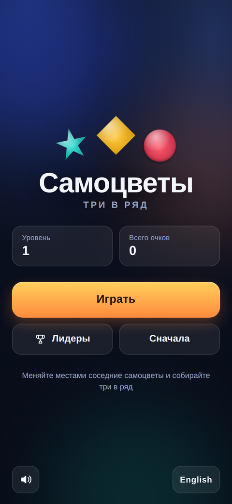
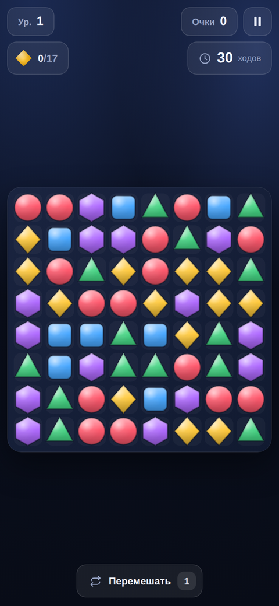
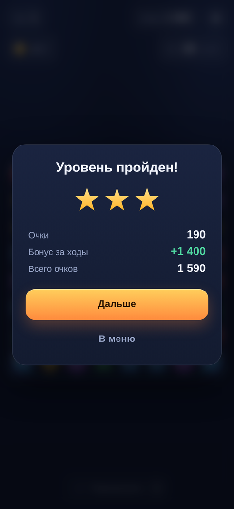

<p align="center">
  
</p>

<h1 align="center">Самоцветы</h1>

<p align="center">
  Браузерная головоломка «три в ряд» на HTML5.<br>
  <a href="https://dr-lexus-dr.github.io/tri-v-ryad.github.io/"><b>Играть в демо</b></a>
</p>

<p align="center">
  
  
  
</p>

## О проекте

«Самоцветы» — головоломка, в которой нужно менять местами соседние фишки и собирать
ряды из трёх и более одинаковых. Уровни строятся по формуле: растёт сложность, ходов
становится меньше, а целей — больше. За уровень даются звёзды, за оставшиеся ходы —
бонусные очки.

Игра написана на чистом JavaScript без фреймворков, сборщиков и внешних файлов:
графика рисуется на Canvas 2D, звук синтезируется через WebAudio. Прогресс хранится
в `localStorage`, поэтому игра работает офлайн после первой загрузки.

## Возможности

- Поле 8×8, свайпы и выбор двух фишек тапами, каскадные совпадения.
- Бонусы за линии из 4 и 5 фишек, множитель за каждый каскад.
- Цели по цветам и лимит ходов, звёзды за прохождение, бонус за неиспользованные ходы.
- Перемешивание поля и подсказка после нескольких секунд без действий.
- Ник перед первой игрой (уникальность не проверяется) и таблица лидеров.
- Сохранение прогресса в браузере: уровень, очки, звёзды, настройки.
- Локализация на русский и английский с переключателем в меню.
- Адаптивная вёрстка: портрет, альбомная ориентация, десктоп; пауза и отключение звука.

## Управление

| Действие | Как |
| --- | --- |
| Обменять фишки | Проведите пальцем или мышью к соседней клетке |
| Обменять тапами | Нажмите на фишку, затем на соседнюю |
| Пауза | Кнопка с двумя полосками в правом верхнем углу |
| Перемешать поле | Кнопка «Перемешать» под полем (один раз за уровень) |
| Звук | Кнопка динамика в меню и в паузе |

## Технологии

- JavaScript (ES-модули), без зависимостей и шага сборки.
- Canvas 2D для поля, анимаций и частиц; CSS для интерфейса и экранов.
- Web Audio API для коротких синтезированных звуков.
- GitHub Actions для публикации демо на GitHub Pages.

## Структура проекта

```
index.html                 разметка экранов
css/style.css              оформление, адаптив, альбомная вёрстка
js/main.js                 состояние приложения, экраны, ввод, сохранения
js/game.js                 правила уровня: ходы, цели, каскады, победа и поражение
js/board.js                поле: совпадения, гравитация, подсказки, перемешивание
js/render.js               отрисовка поля, анимации, частицы
js/platform.js             адаптер окружения и сохранений
js/config.js               адреса Google Формы и таблицы
js/leaderboard.js          отправка результата и чтение таблицы
js/i18n.js                 строки ru/en
js/audio.js                синтезированные звуки
assets/icon.svg            иконка и favicon
assets/screenshots/        скриншоты для README
.github/workflows/pages.yml деплой демо на GitHub Pages
```

## Локальный запуск

ES-модули не работают через `file://`, нужен статический сервер:

```bash
python3 -m http.server 8765
# открыть http://127.0.0.1:8765/index.html
```

Для отладки добавьте `?debug=1` — состояние игры станет доступно в `window.__gems`
(`game`, `renderer`, `save`).

## Демо на GitHub Pages

Демо: **https://dr-lexus-dr.github.io/tri-v-ryad.github.io/**

Публикация настроена в `.github/workflows/pages.yml`: workflow собирает `_site`
из файлов игры и выкладывает его через GitHub Actions. В репозитории нужно только
выбрать источник деплоя: **Settings → Pages → Build and deployment →
Source: GitHub Actions**.

Прогресс в демо сохраняется в `localStorage` браузера, а таблица лидеров читается
из Google Таблицы (см. раздел ниже).

## Таблица лидеров (Google Sheets)

Перед первой игрой игра спрашивает ник — он не обязан быть уникальным и меняется
кнопкой в меню. Результаты уходят в Google Форму, ответы которой пишутся в Google
Таблицу, а игра читает эту таблицу и показывает топ-20.

### Настройка

1. Создайте Google Форму с тремя вопросами типа «Короткий ответ»: **Ник**, **Очки**,
   **Уровень**. В настройках отключите сбор email и разрешите ответы всем.
2. На вкладке «Ответы» создайте таблицу (или привяжите существующую).
3. Возьмите адрес отправки: откройте форму и замените в адресе `viewform` на
   `formResponse`, например
   `https://docs.google.com/forms/d/e/1FAIpQL.../formResponse`.
4. Узнайте ID полей: откройте исходный код формы (Ctrl+U) и найдите строки `entry.`
   — каждому вопросу соответствует свой `entry.NNN`. То же можно получить через
   «Получить предзаполненную ссылку».
5. Откройте таблицу → «Настройки доступа» → «Все, у кого есть ссылка» → «Читатель».
   Из адреса возьмите ID таблицы (`/spreadsheets/d/<ID>/edit`) и gid листа ответов
   (`...edit#gid=<GID>`).
6. Впишите всё в `js/config.js`:

   ```js
   export const LEADERBOARD = {
     formAction: 'https://docs.google.com/forms/d/e/.../formResponse',
     fields: { nick: 'entry.111', score: 'entry.222', level: 'entry.333' },
     sheetId: '1AbC...',
     sheetGid: '0'
   };
   ```

Пока конфиг пустой, игра показывает «Таблица лидеров не настроена», а кнопка
отправки на экране победы скрыта.

### Как это работает

- Отправка — `POST` на `formResponse` в режиме `no-cors`: строка добавляется в
  таблицу, игроку не нужен аккаунт.
- Чтение — Google Visualization API (`gviz/tq`) через JSONP, поэтому CORS не мешает.
  Таблица должна быть открыта на просмотр по ссылке.
- Результат появляется в таблице сразу после отправки; обновление экрана «Лидеры»
  подтягивает свежие строки.
- Очки считаются на клиенте, поэтому подделать их можно: это таблица для друзей и
  сообщества, а не античит. Форму теоретически можно спамить — при необходимости
  закройте её после набора аудитории.

## Правила и баланс

- Поле 8×8; 5 цветов до 5-го уровня, дальше 6.
- Ходы: 30 на первом уровне, уменьшаются на 1 каждые ~1,5 уровня, минимум 14.
- Цели: одна до 9-го уровня, две — дальше; количество считается от числа ходов.
- Линия из 4 фишек даёт +30 очков, из 5 и больше — +60; каскад умножает очки.
- Звёзды: 3 — осталось не меньше 40% ходов, 2 — не меньше 15%, иначе 1.
- Каждый оставшийся ход при победе приносит 50 очков.

## Лицензия

[MIT](LICENSE) © 2026 Lexus
